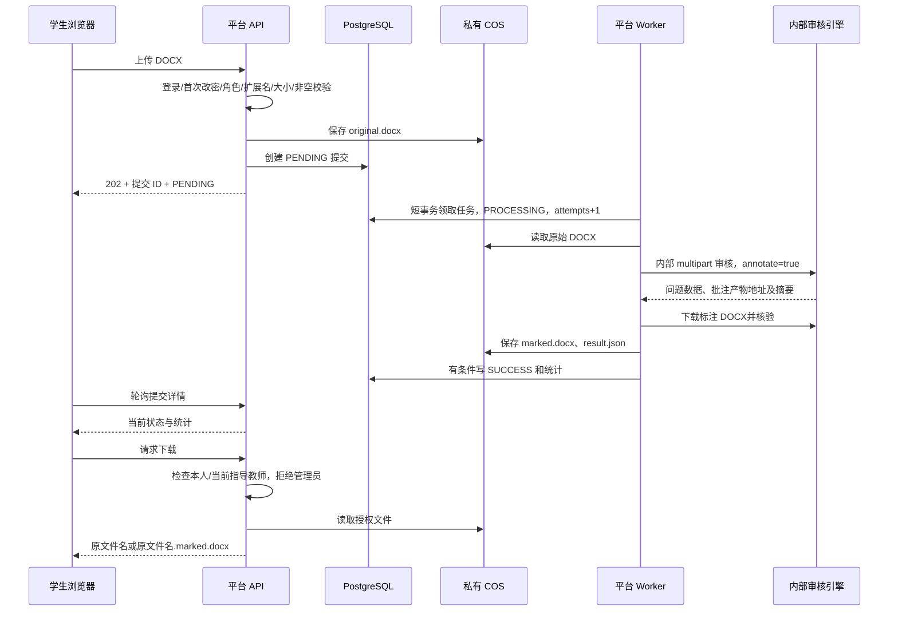

# 平台化后端审计：保留审核内核，新增账号与提交平台

审计日期：2026-10-18。任务模式：只读研究，本文不是已实现功能清单。

依据：用户提供的《需求文档(1).md》v1.0、《数据库设计(1).md》v1.1，以及当前仓库后端、前端接口消费和 Docker 配置。仅新增本文，未改业务代码、数据库、部署或论文。

代码检索说明：当前会话 fast-context 已因 `Windsurf API Key not found` 失败；按工具熔断要求不重复调用，使用 `rg` 和入口到文件系统的调用链阅读替代。

## 1. 结论

当前项目适合作为独立审核引擎保留，但当前 `api.InspectionService` 不是可直接接入账号系统的持久提交服务。它同步执行审核，以内存 Map 保存下载索引，完成后删除原件，并在一小时后清理结果。新平台所需的权限、PostgreSQL 提交历史、COS 文件、异步排队和重试都不存在。

推荐在同一仓库新增平台服务，保留现有 Java 审核引擎为内部 Docker 服务。平台负责账号、归属权限、提交状态、持久任务和 COS；审核引擎只负责文档转换、解析、规则执行、批注及问题数据。不要把账号、ORM 或 COS 写入格式规则类，也不要复制另一套规则实现。

“独立服务”不意味着再给引擎增加另一套业务队列。平台 worker 持有数据库任务，内部同步调用引擎即可；浏览器上传接口立即返回排队状态。

## 2. 已有能力与事实来源

| 部位 | 当前行为 | 与新平台关系 |
| --- | --- | --- |
| `api/InspectionController.java` | 匿名 `POST /api/inspections`；原始 multipart 文件与 `annotate` 参数；同步返回全部结果 | 可作为内部 Adapter 接口的迁移基础，不能继续公开 |
| 同一 Controller | `GET /api/inspections/{requestId}/annotated` 与 `/report`；只有请求 ID，无用户归属判断 | 浏览器必须改走平台授权下载接口 |
| 同一 Controller | `/health` 固定返回 UP；CORS 写死本机与服务器地址 | 不能证明转换器、存储和业务链路可用；迁移后采用环境配置 |
| `api/InspectionService.java:67` | 上传校验、创建独立目录、旧公式转换、内核、批注、Word 报告同步串行 | 可提取为明确的审核执行用例，保留算法与顺序 |
| `api/InspectionService.java:42` | 批注、报告索引存 `ConcurrentHashMap` | 不是提交数据库；重启后即使文件仍在也不可下载 |
| `api/InspectionService.java:110` | finally 删除 `source.docx` | 原始论文必须由平台在审核前上传 COS |
| `api/InspectionService.java:133` | 每五分钟清理过期目录，默认保留一小时 | 仅可用于引擎工作目录，不可管理平台永久文件 |
| `inspection/InspectionKernel.java` | `DocxReader → Docx4jDocumentParser → RuleEngine → DocumentCoverageAnalyzer` | 保留为检测事实和规则的权威路径 |
| `rules/RuleEngine.java` | 确定顺序执行现有章节与对象规则模块 | 平台不解析 XML、不自己计算格式正确性 |
| `reporting/CommentWriter.java`、`AnnotationFindings.java` | 筛选 FAIL、合并同处批注、记录写入状态和真实锚点 | 保留；批注条数与问题条数并不相等 |
| `report/WordReportWriter.java` | 生成包含结果和覆盖情况的 Word 报告 | 新需求不提供报告下载，可保留内部能力，不新增用户入口 |
| `conversion/FormulaConversionService.java` | LibreOffice 经过 DOCX→ODT→DOCX 转换旧公式 | 必须保留明确的转换证据与隔离，不把转换稿冒充原件 |
| `backend/pom.xml` | Java 21、Spring Boot 3.4.3、docx4j、JUnit；没有 Security、ORM、数据库驱动、COS SDK | 新平台基础设施需新建，不存在可“简单开启”的登录/持久化配置 |

现接口响应是 `InspectionResponse(requestId, sourceSha256, ruleSetId, report, annotation, reportFile)`。`report.results` 同时含 PASS、FAIL、REVIEW；`annotation.items` 包含 WRITTEN、UNSUPPORTED_ANCHOR、REJECTED 等写入结果。不能把 `report.results.length` 或 Word 批注数直接当成问题数。

## 3. 保留边界与数据权威

| 数据或行为 | 唯一权威 | 读写路径 |
| --- | --- | --- |
| 用户、角色、禁用、首次改密、师生关系 | 平台 PostgreSQL `sys_user` | 平台认证与用户用例读写 |
| 提交次数、顺序、状态、执行次数、问题汇总 | 平台 PostgreSQL `submission` | 上传用例与后台 worker 更新；前端只读取 |
| 原始 DOCX、标注 DOCX、结果 JSON | 私有 COS | 平台 Storage Adapter 写入；授权后经平台读取 |
| 字体/字号/行距等有效属性、规则结论 | 审核内核与现有规则模块 | 仅引擎解析原件或明确标识的转换稿 |
| 问题总数 | 引擎 Adapter 的稳定投影 | 按已有口径取 `judgement=FAIL` 的结果条数；平台不再计算另一种“问题数” |
| 可选章节统计 | 引擎识别到的章节归属 | 不能根据规则名前缀猜章节；没有可靠归属时返回 null |
| 是否已写入批注 | `AnnotationReport` 与文件回读验证 | 不能由问题条数推断 |

已有 `RuleCatalog` 的 module 是“正文标题、页眉、插图、图表题”等规则领域，不等同需求中的八个章节模块。例如 CAPTION-FONT 可出现在正文或附录，ABSTRACT-FONT 也可能作用于中英文摘要。首版应返回 `by_scope=null`，除非同时建立并验证从 `source/contextSource` 到文档章节的稳定投影。

## 4. 推荐数据流



数据库事务不能跨整个 COS 上传或审核过程保持锁。COS 与数据库没有分布式事务，须显式处理部分完成：对象上传成功但建记录失败时清理该次尚未提交的对象；结果上传成功但状态提交失败时保留可恢复证据，以相同提交 ID 和执行版本对账，不能重新创建提交。

业务成功文件永久保留与临时失败上传清理是不同范围，清理对象必须由服务生成的完整 COS key 决定，不能根据用户文件名拼路径。

## 5. 内部引擎契约

### 5.1 可立即复用的接口

- 请求：`POST /api/inspections`，multipart `file`、`annotate=true`；`X-Request-Id` 为规范 UUID。
- 当前响应：使用现有 `InspectionResponse`；worker 只从配置的引擎 origin 访问返回的相对下载地址，不接受任意域名或用户提供的 URL。
- 当前幂等限制：同一请求 ID 第二次调用返回 `REQUEST_ID_CONFLICT`，不会读取旧结果。数据库提交 ID 不能直接作为所有重试的请求 ID；每次执行使用单独 UUID，关联提交 ID 与 attempts，写入结构化日志和结果 JSON。
- 超时或连接中断后不能认为引擎一定未执行。平台最多提交一次终态；旧执行返回也只能通过执行版本条件更新，不能覆盖新执行结果。
- 获取成功响应后立即下载批注和结果数据到 COS，引擎本地地址只作为临时传输凭据，不保存给最终用户。

### 5.2 推荐增加的内部响应投影

不改变规则语义，只在执行 Adapter 输出稳定元数据：

```json
{
  "contractVersion": "1",
  "requestId": "每次执行的UUID",
  "engineVersion": "镜像构建版本或提交哈希",
  "ruleSetId": "school-v1",
  "inputSha256": "上传原始DOCX的摘要",
  "inspectedSha256": "实际被检测DOCX的摘要",
  "conversionApplied": false,
  "problemCount": 42,
  "byScope": null,
  "annotation": {
    "available": true,
    "downloadPath": "/api/inspections/UUID/annotated",
    "sha256": "标注文件摘要",
    "unwrittenFindingCount": 0
  }
}
```

具体说明：

1. 当前 `sourceSha256` 来自 `kernel.inspect(inspectionSource)`，发生公式转换后它是转换稿摘要。平台原始上传摘要必须独立计算并命名，不能复用这个字段。
2. `school-v1` 在多次修复中一直不变，单靠该 ID 无法追溯规则版本；结果 JSON 至少记录不可变的构建版本。
3. 问题数沿用当前前端和 Word 报告的 FAIL 条数，不静默改为去重数或批注数。若未来调整计数语义，应增加契约版本并重新验收。
4. `byScope` 无证据则 null；不要返回八个虚假的 0。
5. 完整 `InspectionResponse` 可内部保存在 COS 的 `result.json`，不对学生/教师暴露问题明细 API，不对管理员暴露论文内容。
6. `annotation.available=false` 不满足“审核成功可下载标注 Word”，应视为审核执行失败。部分意见未写入也不能悄悄当作完整交付；建议通过严格的标注产物验证门，或先明确用户可见的部分完成状态。本期仅四态，最保守是写入失败时 FAILED 并记录技术原因。

### 5.3 错误与重试分类

当前错误状态不能原样成为平台重试策略：`FORMULA_CONVERSION_FAILED`、`REPORT_GENERATION_FAILED` 会落到 HTTP 400；统一把 RuntimeException 包装为 `PARSER_FAILED` 也会混合文档问题与实现异常。

| 类型 | 推荐平台处理 | 学生说明 |
| --- | --- | --- |
| 扩展名、空文件、50 MB限额不合规 | 上传同步拒绝，不建记录 | 指明允许的格式/大小 |
| DOCX损坏、ZIP/XML不安全、缺关键部分 | 已接收的审核记 FAILED，不重试 | 文件无法读取，请用 Word重新另存为 DOCX后上传 |
| 规则说明文档冒充论文 | FAILED，不重试 | 上传的是规范文档，请上传论文 |
| 特定文档无法转换、转换造成公式丢失 | FAILED，不盲目重试 | 文件中的公式无法安全处理，请检查后重新提交 |
| 引擎连接失败、超时、503、进程异常 | 有上限退避重试，同一提交增 attempts | 最终仍失败时用需求规定的服务异常提示 |
| COS暂时不可用、结果传输失败 | 有限重试，保留执行版本与原始对象 | 不把存储失败显示成论文格式有错 |
| 认证失败、协议响应不完整 | 运维错误，停止重复尝试并告警 | 审核服务异常，请联系管理员 |

推荐初始策略为最多 3 次执行、指数退避并加抖动；确切次数/超时作为运维配置。先建立引擎明确的文档错误与运行时错误类型，再据此判定可重试性，不能仅看 HTTP 400/422。

## 6. 队列、恢复与并发

`submission` 本身可作为第一版持久任务源，无须引入第二套内存队列作为权威。进程重启后扫描 PENDING 和过期 PROCESSING；领取任务、attempts 递增以及完成写回必须是带条件的数据库操作。

数据库设计只有 `attempts`、`started_at`，还没有 lease、heartbeat 或版本字段。单 worker 也会遭遇“旧请求超时后继续执行，新请求已重试”的竞争。至少用领取时的 attempts 作为执行版本，终态更新要求同一 submission、PROCESSING、同一次 attempts；若采用显式 lease/version 字段应由主设计同步更新 schema，而不是藏在内存 Map。

实现遵循平台选定 ORM/Repository。若数据库锁领取必须使用 PostgreSQL 专有功能，应局限在队列 repository Adapter，记录接口和并发测试；不要让 SQL分散到 Controller 和业务模块。

短期 worker 并发建议 1，先取得真实 50 MB文档的内存/耗时证据再提高。当前引擎会把压缩包与展开内容读入内存，Docx4j再建模型，不应按压缩文件大小直接估算实例内存。需要任务超时、最大排队和队列年龄指标。

LibreOffice 当前无执行超时、无专用 UserInstallation profile，并在 `readAllBytes()` 后才 `waitFor()`。多个任务可能争用同一 profile，挂起会长期占住线程。平台异步化之前应补进程超时、独立工作 profile、退出回收与可分类错误；这属于转换 Adapter修复，不需要改公式规则。

## 7. 50 MB要求的五层限制

当前至少以下位置冲突，不能只调整上传页面：

| 层 | 当前限制 | 迁移要求 |
| --- | --- | --- |
| 前置 Nginx `client_max_body_size` | 16m | 请求体上限大于等于50 MB文件加multipart开销 |
| Spring multipart | 文件16 MB、请求16 MB | 文件统一50 MiB或明确十进制MB；请求上限保留协议开销 |
| Tomcat max-swallow-size | 20 MB | 与拒绝大文件行为共同验证，保证返回可读错误 |
| `InspectionService.maxUploadBytes` | 16,777,216 | 与公开上传限制一致，内部调用也受限 |
| `DocxReader` | 压缩16 MiB、单part16 MiB、总展开50 MiB、10,000 entries | 通过一个配置拥有者传入解析器；压缩、单part、展开总量独立配置并压测 |

扩大文件限制不意味着取消ZIP炸弹和XML安全校验。50 MB压缩文档可能远大于50 MB展开内容，需根据样本与实例资源制定独立展开上限。公式转换在 `DocxReader` 前运行，当前 `FormulaConversionService.documentXml()` 无读取长度上限，因此安全预检必须在外部转换前发生。

## 8. 平台公开API建议

所有 ID以字符串返回，避免JavaScript对 bigint精度损失。时间使用UTC ISO-8601；分页约定 `page`、`pageSize`、`total`，排序稳定增加ID作为同时间的次序。响应建议统一 `{data, requestId}`，错误 `{error:{code,message,fieldErrors},requestId}`。

| API | 行为与权限 |
| --- | --- |
| `POST /api/auth/login`、`POST /api/auth/logout`、`GET /api/me` | 认证及本人信息；禁用和首次改密由后端强制 |
| `POST /api/me/password` | 当前密码、新密码、确认密码；成功后按认证策略失效旧凭证 |
| `POST /api/submissions` | 仅启用且已改密的学生；multipart上传；202返回PENDING |
| `GET /api/submissions` | 学生仅本人列表，稳定倒序分页 |
| `GET /api/submissions/{id}` | 仅学生本人或当前指导教师；管理员拒绝 |
| `GET /api/submissions/{id}/files/{original\|marked}` | 每次执行同一归属鉴权；FAILED状态不提供下载 |
| `GET /api/teacher/students` | 仅名下学生；搜索学号/姓名、学号升序分页 |
| `GET /api/teacher/students/{id}/submissions` | 先验证学生当前归属，再查询提交 |
| `/api/admin/users`与导入接口 | 仅用户管理，不复用允许论文读取的管理员万能权限 |

学生身份应来自已验证 principal，不能接受客户端 `studentId` 决定归属；教师访问关系查询 `sys_user.teacher_id`，不能信任旧前端缓存或请求参数。管理员不能用“管理员拥有全部权限”的默认框架策略绕过论文禁读。

采用私有COS；对象 key保存于数据库限定目录下。优先授权后流式代理下载，以确保每次请求实时验证禁用、教师改派和首次改密限制。若使用短期预签名URL，须明确URL在失效前仍可用的窗口；不能宣称禁用后所有已签名链接立即失效。

标注下载名按照 `原文件名去掉.docx + .marked.docx` 生成，Content-Disposition使用UTF-8；不能继续返回 `thesis-annotated-UUID.docx`。用户提供的文件名仅展示，不参与本地或COS key计算。

## 9. Docker与运维变更

- Compose新增 platform、PostgreSQL；审核引擎只在内部网络 expose，不发布宿主端口。前端 `/api` 只代理platform，彻底关闭旧匿名 `/api/inspections` 公网绕过路径。
- COS凭据仅注入platform，审核引擎无需COS账号、用户密码或数据库凭据。平台到引擎至少使用独立内部服务凭据；同网不等于鉴权。
- backend现 Dockerfile单阶段复制本机 `target/app.jar` 且root运行。平台化发布采用可重复多阶段构建与非root用户，LibreOffice工作目录明确可写，镜像固定大版本并通过CI构建。
- 保留引擎临时目录清理，但不再将临时目录作为正式历史存储；成功论文在COS永久保存，数据库永久保留记录。
- 当前 `/health` 只是活性。新增就绪检查验证工作目录、转换器可用性；平台就绪检查验证数据库和必要配置，COS可设置轻量探测或单独状态，避免每次健康检查做大文件操作。
- 记录 requestId、submissionId、attempt、engineVersion、耗时、错误码、文件字节数；不记录论文正文、口令、签名URL或COS密钥。全量结果仅在受控COS保存。
- 进程优雅停机停止领取新任务，现任务限时收尾；恢复扫描不能将仍在另一实例执行的任务当成失败。

## 10. 需要主设计明确的冲突和风险

1. 需求“失败提交不保留文件”与“提交记录及文件全量保留”存在范围重叠。推荐明确后者仅指成功提交；FAILED删除原件和部分产物，但保留记录。排队/处理期间原件仍允许下载。
2. 当前完整响应包含问题原文、XML定位等数据，而新平台不提供逐条问题页面或数据下载。公开DTO只返回统计与授权下载能力，不能透传现响应。
3. 仅FAIL为0不能证明全部规范均可确认，现引擎有REVIEW与覆盖缺口。需求“全部通过”文案可能超过引擎证据，应定为“未发现可判定的格式错误”或由用户明确接受该展示含义；不能将REVIEW静默变PASS。
4. 新需求不做PDF及版面类规则，但现引擎已有页码/分节XML检查。建议保留现引擎行为，先明确“版面类不做”指不新增PDF排版还是禁用既有XML页码规则；未经确认不顺便删除已验证规则。
5. 目前无逐条章节scope，首版 `by_scope=null` 符合需求，不应为看起来完整而伪造统计。
6. 初始密码和最大128字符与BCrypt的72字节输入限制应在平台认证设计明确；非ASCII密码按字符上限与字节上限不能混用。数据库 `password_hash varchar(72)` 是哈希存储长度，不解决密码输入限制。
7. PostgreSQL两张表不足以自动获得安全队列和会话撤销语义；对lease/version、认证失效字段是否新增要有明确决策，不能以进程内状态假装持久化完成。

## 11. 验收顺序与回归边界

1. 先固定引擎版本，运行全部Maven回归；当前16篇样本保留结果指纹及关键批注证据，不在平台化时同步改学校规则。
2. 引擎Adapter契约测试覆盖正常DOCX、Visio图题、公式转换、损坏文档、超时、无批注产物、部分批注失败、重复请求ID及错误分类；真实核心逻辑不Mock。
3. 使用真实PostgreSQL验证两worker竞争、重启恢复、attempt条件提交、重复回包、失败终态及同时间提交顺序。测试可用Testcontainers，不能用内存Map代替持久队列验收。
4. 使用专用私有COS测试前缀做实际上传、下载、失败清理和访问拒绝；本地测试替身仅隔离单元边界，不代替部署验收。
5. 权限矩阵覆盖学生跨人、教师跨归属、管理员论文禁读、禁用用户、首次改密与教师重新分配。旧匿名引擎路径从公网必须不可访问。
6. 50 MB临界值、multipart额外开销、解压限额、大小写扩展名、损坏ZIP、文件名换行/路径字符、中文下载名都经过真实HTTP链路验证。
7. Docker真实启动后完成“建账号→强制改密→上传→PENDING/PROCESSING/SUCCESS→下载两份DOCX→教师授权查看”的业务冒烟；随后验证引擎或worker重启不会丢提交。

本文仅完成静态审计；没有运行新的平台测试、建库或部署。正式实现需由主Agent将以上边界收敛到批准的蓝图、schema与接口契约。
