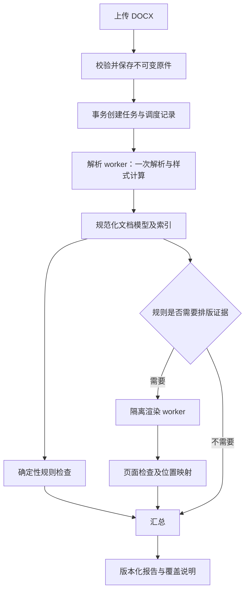

# 开源选型与 Word 准确解析架构

日期：2026-10-03。任务：规则确认、开源研究与架构设计；不实现生产代码。

更新：2026-10-04 进行了新一轮源码、测试和许可证核查，见 [第二轮研究结论](第二轮开源与解析研究结论.md)。该文补充 PaperFormatDetect、docx2hub，纠正旧分支信息和许可证缺口；架构仅为候选，不是已经批准的设计。

## 1. 已确认的依据

用户要求严格按《论文规范.docx》执行，所有节四边页边距为 2.6 cm。未规定的图片尺寸、公式主体字号等不能自行加入规则；有歧义的原文不能伪装为确定性结论。

来源文件实际位于 `C:/Users/Lenovo/xwechat_files/wxid_6tcczogt6slf22_4d6d/msg/file/2026-10/论文规范.docx`。用户粘贴路径中的额外分隔符不存在，已核对实际文件。目录其他文件不是此次论文规范来源，未读取其内容。

文件 SHA-256：`3c9c3dc012b779b4ebd20ea35cb86142d73fb911c7733e3b0d1789ce2d6ac2b2`。本地结构证据保存在 `template-structure-evidence.json`。

实际观察：

- 10 个 sectPr；第 7 个的 right=1418，其余所列四边为 1474。
- 2 个 Equation.3 嵌入对象；0 个 OMML oMath。
- 61 个 mc:AlternateContent，其中 Choice 与 Fallback 各含 57 个文本框。不能把两条表示分支同时当成正文。

这些计数来自原始 XML 结构扫描，不等于完成了 Word 排版或全部逻辑对象识别。

## 2. 开源项目评估

采用项目原始 README、源码、GitHub 元数据和 Microsoft 文档作为证据。未执行远程仓库代码、未安装项目或上传论文。活跃度与星数只辅助评估，不能证明准确性。

| 项目 | 已核查的证据 | 建议用途 | 限制 |
| --- | --- | --- | --- |
| [docx4j](https://github.com/plutext/docx4j) | README 明确 JAXB/OpenXML 包模型、Apache 2.0；PropertyResolver 源码有 getEffectivePPr/getEffectiveRPr、样式继承和表格样式相关处理 | Java 主解析组件首选，复用对象模型与属性解析，针对真实缺口补边界 | master README 有旧版本内容，不能照抄其中版本；本次未确认当前发布版本；有效样式 API 不代表全部 Word 布局语义已覆盖 |
| [Apache POI](https://github.com/apache/poi) | 官方 Apache 镜像 API 可访问，未归档，返回近期提交；README/LICENSE 本次网络读取失败 | 备选；尤其可评估 POIFS 读取 OLE 容器 | 本次证据不足以推荐 XWPF 作为完整有效样式引擎；接入前核对正式发布包、许可证、限制与测试 |
| [Open XML SDK](https://github.com/dotnet/Open-XML-SDK) | README 明确低层 OPC/XML API、不是高层排版工具；MIT；API 显示未归档 | 标准映射和离线交叉校验参考；若改选 .NET 才作主解析器 | 不为了校验而给生产系统引入第二语言服务；schema 校验不代表校规通过或页面渲染正确 |
| [JODConverter](https://github.com/jodconverter/jodconverter) | API 明确基于 LibreOffice/OpenOffice 转换；README 标注 Apache 2.0；LICENSE 读取失败，API 许可证为 NOASSERTION | 独立渲染 worker 候选，用于 PDF 预览和版面检查试验 | 正式接入前核对发行包 LICENSE/NOTICE 和 LibreOffice 许可证；不能把 LibreOffice 的分页等同于 Word |
| [db-scheduler](https://github.com/kagkarlsson/db-scheduler) | README/API：Apache 2.0，数据库持久化、单次任务、Spring Boot 集成、重试和集群调度；当前 README 要求 Java 17+ | PostgreSQL 支持的持久化任务调度，避免增加消息中间件 | 文档的吞吐数字不是本项目性能证据；任务执行仍按可能重复处理，需要幂等和恢复测试 |
| [format-comparator](https://github.com/Iberxilong-blackbox/format-comparator) | 已读完整 README：Windows + Word COM + Streamlit，LLM 辅助样式映射，同步执行 | 参考问题报告、原文批注和人工对照体验 | 不推荐直接 fork 为学校服务：桌面 Word 强依赖、同步处理、判定映射依赖 LLM；许可证未核实，不能直接复制代码 |
| [paper_format_agent](https://github.com/zxyasfas/paper_format_agent) | README 自述 MIT、本地排版和文本指纹；明确早期项目，公式/脚注/复杂布局较弱 | 参考内容保护、回归 fixture 和规则表达思路 | 是排版修改工具；正文指纹排除页眉页脚并归一化文本，不能证明完整文档无损；不推荐作为严格检测底座 |

结论：复用成熟文档和任务组件，自建学校规则内核；本次没有发现已被充分验证、可直接 fork 后承诺满足本校严格要求的成套项目。这个结论限于此次检索和证据，不声称开源生态中绝不存在此类项目。

## 3. “准确无误”的工程定义

不能承诺对任意 DOCX、任意字体环境、所有旧公式和所有规范歧义零误差。可以承诺：明确支持的规则使用确定性计算、有原始证据、可重现；未知/不支持/失败必定可见，不错误通过。

区分三层：

1. 文件事实：XML 中保存什么，以及值来自哪里。
2. 有效格式：按标准的继承与覆盖规则，文字实际请求什么格式。
3. 渲染事实：在固定应用、版本、字体集和设置下，最终显示在哪里、使用什么字形。

XML schema 合法不等于格式符合学校要求；文字请求“宋体”也不等于服务器实际用宋体渲染。

## 4. XML 解析路线

### 4.1 安全读取包与选择兼容分支

按 OPC 的 Content Types 与 Relationships 定位部件，不只硬编码 document.xml。识别 Strict/Transitional 命名空间，按库的实际支持情况处理；不支持时明确拒绝或报告。读取正文、styles、numbering、settings、theme、fontTable、页眉页脚、脚注尾注和关系文件。

ZIP 限制条目数、展开字节、压缩比、单对象尺寸、执行时间；禁止路径穿越、XML 外部实体/DTD、外部资源抓取；不执行 OLE。原文件只读，转换只用隔离副本。

mc:AlternateContent 按 Requires 与解析器声明的能力选择一个 Choice，否则选 Fallback；不是永久删除所有 Fallback，也不能两条都读。保存采用分支与能力版本。对不支持的 mustUnderstand 等条件明确失败。

文本框单独作为文档区域；不能让正文段落遍历再次递归重复收集其中段落。修订、隐藏文字、域代码/域结果需要显式策略：有未决修订时给出检查视图和复核提示，不悄悄接受或拒绝修订。

### 4.2 构建有效格式解析器

Microsoft 的 RunProperties 文档给出样式层级：document defaults → table styles → numbering styles → paragraph styles → character styles → direct formatting。每类属性的细则不同，不能实现成所有字段统一的字典覆盖。

优先使用 docx4j PropertyResolver，并以标准和测试核验其适用范围。表格条件样式、编号属性、basedOn 链、主题字体、缺失值、toggle 属性和复杂脚本是专项样本，不把调用库方法视为完成验收。

每个有效属性保存 value、unit、originPart、originNode、resolutionTrace、status。缺失但按标准可继承的属性正常解析；无法解析的值保持 unknown，不用宋体/12pt 等默认值冒充。

中文与西文字体分别解析 eastAsia、ascii、hAnsi、cs 及相应 theme 属性，结合字符类型、语言和 hint。一个 run 可以混合中文和英文，需要按文字片段检查，不能只抽查第一个 run。字体名称别名必须基于已核查映射，不模糊匹配。

基于样式的粗体等 toggle 语义与直接设置不同，必须按属性规则处理。不存在节点不自动表示 false。段落标记格式也不能无条件覆盖每一个文字 run。

### 4.3 精确单位与边距

- 常用字号 sz 以半磅保存：小四 12 pt 对应 24，五号 10.5 pt 对应 21。
- 1 inch = 1440 twips；2.6 cm = 26 mm = 1474.015748… twips，常用整数表示规范化为 1474。
- 对整数 twips 边距，第一版严格比较规范化整数 1474；1418 必须失败。若遇标准支持的其他度量编码，按精确有理数换算并应用声明的表示精度，不做字符串比较或宽泛容差。
- 首行 2 字符通常由 firstLineChars=200 表示；firstLine 为物理长度，不能无条件把 24pt 等同 2 字符。字符值和长度值同时存在时按标准优先级处理；空格冒充缩进不通过。
- 自动倍数行距 line=360、lineRule=auto 对应 1.5 倍；固定行距 exact=360 是 18pt，不能混为一谈。还要记录文档网格、snapToGrid 与上下文间距等影响。

所有适用节都检测，处理段落级 sectPr 与末尾 sectPr 的范围、页眉页脚继承、首页/奇偶页设置、页码重启、镜像页边距和装订线。不能只读最后一节。

### 4.4 内容分类和引用索引

建立章节、段落、图片、表格、公式、题注、引用索引；按结构/内容/上下文识别摘要、正文、参考文献和附录，不仅看样式名称。避免“标题字体错了 → 被识别为正文 → 没有标题错误”的循环。

优先处理明确标题文本、编号定义、outlineLvl 和序列关系；冲突或边界不确定时标记需复核，不由 LLM 裁决硬性规则。学校语义与结构规则保存在可测试 domain 模块。

同时解析手输编号、SEQ/REF/PAGEREF/TOC 域以及自动列表 numId/abstractNum/lvlOverride。保存域代码与缓存结果；缓存可能过期，不能把 PAGEREF 缓存当精确页码。不得为获得新缓存而改写原件。

规则检查覆盖每一个适用文字片段；汇总显示时合并连续同类问题，底层证据不丢失。参考文献按首次引用顺序、重复引用、缺失条目做索引匹配，支持多编号/范围等真实引用形式。

### 4.5 图片、表格和公式

图片区分 drawing inline/anchor、VML、矢量图、组合图形与 OLE 预览图；不把公式的预览 WMF 当作独立插图。提取尺寸、裁剪和锚点，但只检测学校实际规定的属性。

图题“下方”和表题“上方”先建立语义关联，浮动对象的最终视觉关系用渲染证据验证；XML 前后顺序不是屏幕上下位置。

表格检查有效边框（含表样式、单元格覆盖）、合并、表头重复和续表标识。三线表允许辅助线，不以边框数量直接判错。

公式分别标识 OMML、Equation.3、其他 OLE、疑似图片公式。OMML 可结构读取；Equation.3 是复合二进制对象，外层 XML 不含完整公式结构，POIFS 也只解决容器读取，不能代替 MTEF 语义解析。

本轮没有核实可满足严格需求的成熟 MTEF 解码器；第一版必须能识别对象并检测可获得的编号、编号样式和引用，对内部不可解析项标记需复核。学校本身未规定的公式主体字体和字号不检测。后续若新增明确规则，再单独验证旧公式解码能力。

### 4.6 渲染与位置

设置固定 rendererVersion、fontManifestHash、locale、compatibilityProfile。LibreOffice/JODConverter 可用于开源预览，但学校若以 Microsoft Word 为准，必须用授权的固定 Word 环境制作对照金样；不能宣布两个排版引擎天然等价。

DOCX→PDF 不是自动获得 XML→页面坐标映射。页码定位需单独验证 adapter 的对象/文本映射，重复文本、连字、换行、浮动对象无法可靠对齐时只给稳定章节/段落定位，并显示页面定位未确认。

lastRenderedPageBreak、域缓存和文档属性页数都可能陈旧；不得单独作为权威。PDF 全文 OCR 不替代 DOCX 属性检测。

## 5. 架构决策

推荐 Java 21 LTS + 兼容的受维护 Spring Boot/docx4j 版本；版本在试验和依赖扫描后锁定。单代码库模块化单体，API 与 worker 分进程部署，渲染使用受限独立进程/容器。共享 PostgreSQL 与受控文件卷。初期不用微服务、Redis、Kafka、通用规则 DSL 或 LLM 检测链。

边界：document adapter 拥有格式语义；rules 拥有学校规则；inspection 拥有编排与重试；reporting 拥有证据展示；controller 不处理 XML，规则不直接访问数据库。

持久化任务优先 db-scheduler。创建业务任务与调度记录应在同一数据库事务中完成，使用调度器支持的事务集成；若所选版本不能保证，明确采用事务 outbox，而不是两次独立写入。验证断电窗口、锁释放和重试，不能宣称 exactly-once。

任务按至少一次处理设计：jobId/stage/version 唯一约束，结果原子提交，临时文件写完再发布；相同任务重试不产生重复正式报告。只重试瞬时 I/O/资源错误，损坏文档、缺字体、未知格式不反复重试。

状态增加 rendering/assembling；completed 只表示运行结束。报告另存 complete/partial/blocked 覆盖状态及每条规则 pass/fail/review/not_applicable/not_checked。需渲染却渲染失败时不影响已计算事实，但总体不得显示“全部合格”。

## 6. 效率策略与验证

核心目标是降低重复解析和渲染成本，而不是给每个段落开线程。

- 一份文档一个主解析过程，样式图与引用索引一次建立。按对象类型/区域分发规则，避免每条规则全量扫描 XML。
- 样式链 memoization，并检测循环；缓存键覆盖字符类型、表格条件样式、编号和主题等上下文，不能只按 styleId 缓存所有有效格式。
- 解析缓存键：fileHash + parserVersion + extractionProfile。检测键另加 ruleSetVersion；渲染键另加 rendererVersion + fontManifestHash + options。缓存复用不得绕开用户文件授权。
- 尽量顺序遍历，媒体按需读取；规范化模型保留必要属性和来源，不把所有二进制媒体复制进 JSON，不逐 run 写数据库。
- 文档之间采用有界并发；渲染池单独限流，初始保守配置，通过 CPU/RSS/队列等待数据调优。不同任务使用独立工作目录和 LibreOffice profile。
- PostgreSQL 存任务、报告摘要和可筛选 findings；大解析快照按需压缩保存在受控文件卷，遵循相同删除/保留策略。
- 首轮记录上传、解析、有效样式、规则、渲染、导出各阶段耗时及峰值内存；分别测普通论文、长论文、图片密集、公式密集文档和并发 1/2/4。以 p50/p95、最大内存和失败率决策，不预先宣称秒级或“最高效”。

## 7. 准确性验收

采用真实授权样本 + 受控变体。合格与违规由人工独立标注，不能拿同一套解析代码生成预期值。模板自身违规必须检测出来。

第一批必测：

1. 四边 1474 通过，第 7 节 1418 失败；其他三边正确不能掩盖一边错误。
2. 直接格式与继承格式等效；一个 run 错字体或字号能定位到片段。
3. 同一段中西文分别指定字体，主题字体解析与缺字体分别报告。
4. firstLineChars=200 与空格伪装、物理长度表达不混淆；1.5 倍与固定 18pt 不混淆。
5. Choice/Fallback 只选择一份逻辑内容；不把兼容预览图片重复计为公式/插图。
6. 标题格式错误仍被识别为标题；附录编号不套用正文规则。
7. 所有适用节及页眉页脚继承、页码重启、跨页表头均覆盖。
8. Equation.3、OMML、图片公式分类正确；未知内部格式不返回通过。
9. 标题/题注/引用混用手输与域代码，缓存失效能被识别或标记需复核。
10. 损坏 ZIP、超大展开体积、外部关系和超时失败明确；重启/重试不会重复正式报告。

报告每类规则的误报、漏报与覆盖率；所有已冻结回归样本符合预期只是发布门槛，不代表任意输入零误差。Word 视觉对照与开源渲染差异单独记录。

## 8. 执行顺序与研究限制

下一步先做受控能力试验：规则 manifest → Java/docx4j 读取学校模板 → effective style 样本 → 2.6 cm 与兼容分支回归 → 公式分类 → 固定环境渲染对照 → 性能测量。通过后才进入服务和前端开发。

本次已完成：源码/README/官方文档层面的研究，实际学校模板底层 XML 检查，以及架构设计。未完成：Java 组件运行、真实论文样本评测、Word/LibreOffice 渲染一致性测试、性能基准、发行版本与完整传递依赖许可证审计。

工具限制：当前无 fast-context 或专用 web 搜索工具，使用 GitHub API/官方 raw 文件和本地 XML。PowerShell HTTPS 首次失败后改用 Python HTTPS；部分地址出现 TLS EOF/握手超时，相同失败路径最多追加一次重试后停止。未成功读取的来源不作为已证实结论。未因研究任务安装新的 skills 或执行远程代码。

## 9. 主要来源

- docx4j README：https://raw.githubusercontent.com/plutext/docx4j/master/README.md
- docx4j 有效属性解析源码：https://github.com/plutext/docx4j/blob/master/docx4j-core/src/main/java/org/docx4j/model/PropertyResolver.java
- Microsoft 样式层级：https://learn.microsoft.com/en-us/dotnet/api/documentformat.openxml.wordprocessing.runproperties?view=openxml-3.0.1
- Open XML SDK：https://github.com/dotnet/Open-XML-SDK
- JODConverter：https://github.com/jodconverter/jodconverter
- db-scheduler：https://github.com/kagkarlsson/db-scheduler
- 论文项目 README 及部分成功读取源码保存在 `sources/`；失败结果保存在 fetch-results.json/retry-results.json。网络来源未锁定 commit，实施选版后必须固定 tag/commit 并复核。
