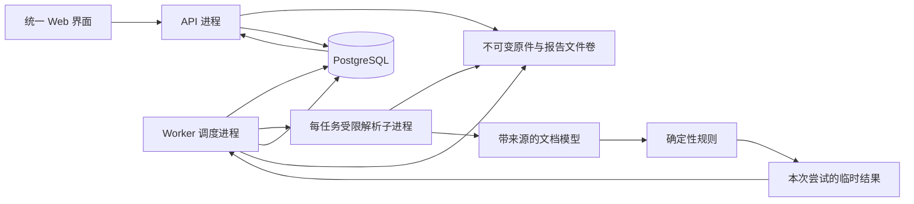

# 论文格式筛查核心系统设计

日期：2026-10-04；实施切片确认：2026-10-07。状态：已批准按“检测内核第一期”进入实施；本文件没有对应的生产功能完成声明。

依据：[58 项学校规则及验收清单](../../research/学校规则矩阵与核心验收清单.md)、第一至八轮研究。原规范 SHA-256 为 `3c9c3dc012b779b4ebd20ea35cb86142d73fb911c7733e3b0d1789ce2d6ac2b2`。

## 1. 目标、范围与成功标准

面向学校论文提交者和检查人员，提供同一套上传、查看进度、查看问题和下载报告流程，不划分教师端/学生端。用户已明确暂不实现登录注册；首版是无账户的共享工作区，所有访问该实例的人使用同一任务列表，不提供“本人文件”或用户隔离语义。默认面向本机或受控内网使用。

首版建议自动执行：已经明确适用范围的字体、字号、加粗、行距、首行缩进、全部分节页边距，以及在结构可识别时的标题、图表公式编号、引用和参考文献规则。不能识别作用域或缺少有效属性时，给出具体复核原因。

用户已确认首版采用“确定性规则 + 明确复核”范围。首版不自动裁决：实际分页、图题同页、浮动对象最终位置、实际字体替代、旧公式内部字号、变量说明语义及有歧义的学校条款。它们仍出现在覆盖说明中，不静默消失。该范围确认不等于下文全部技术细节已经评审通过。

不做登录、注册、账户管理、角色权限、查重、AI 写作鉴定、内容评分、自动改稿、在线 Word 编辑器、多学校配置平台或教师审批流。输入先限定 DOCX；导出报告不是支持 PDF 论文输入。

成功标准：每个结论可追溯到规则原文及论文证据；已支持规则通过独立样本验收；无法判断不当作通过；异常文件不会阻塞其他请求；服务重启后任务可恢复；一条真实上传至报告下载的流程通过验证。

## 2. 方案比较与技术选择

| 方案 | 优点 | 代价 | 决策 |
| --- | --- | --- | --- |
| HTTP 请求同步解析 | 实现直观 | 超时、内存、重启恢复与上传重试难处理 | 不采用正式服务 |
| Java 模块化单体 + PostgreSQL 持久化任务 + 隔离解析进程 | 部署组件少，证据与事务边界清晰，可复用已试验组件 | 需要任务幂等和资源限制，子进程启动有成本 | 推荐 |
| 多语言微服务 + 消息总线 + 常驻公式/渲染服务 | 可独立扩展 | 运维与一致性复杂，现有精度缺口不因此消失 | 当前不采用 |

建议后端 Java 21 LTS、Spring Boot 3.5 系列、docx4j 17.2.1、PostgreSQL、JPA/Hibernate、Flyway、db-scheduler。研究运行环境是 Java 23，尚未证明此组合在 Java 21 上通过；工程骨架阶段先验证兼容性和支持周期，再锁定精确依赖版本，不将本建议冒充已经构建通过的配置。

前端 React + TypeScript + Vite + Tailwind CSS，React Router 管路由，TanStack Query 管服务端状态，React Hook Form + Zod 管表单。基于 Tailwind 的组件体系保持单一，采用 shadcn/ui 的必要组件；不引入第二套后台框架。视觉稿尚未设计。

业务数据库访问走 JPA，数据库结构由显式 Flyway 迁移维护。db-scheduler 使用其官方表结构和访问实现，不在业务代码中复制调度 SQL。依赖选择以维护状态与真实兼容测试为发布门，不写动态版本。

## 3. 部署与数据流



API 与 worker 使用同一个后端代码库和镜像，通过明确运行模式启动。worker 承担数据库租约、心跳与超时监督；解析子进程不持有数据库凭据，只读取调度器分配的一个任务文件并写入自己的临时目录。它不执行 OLE，不抓取外部关系 URL。

首版每个 worker 同时运行 1 个解析子进程；以后按实测内存和耗时增加 worker 数。父进程监督超时并结束整个子进程，而不是用线程 interrupt 假装取消仍在工作的解析库。无渲染时不部署空的渲染服务。

每任务子进程有冷启动和字体扫描成本，不能宣称性能最优；选它是为了可控制失败。先测试此方案，只有性能数据证明需要，才改为有任务数/内存回收边界的常驻解析池。

## 4. Source of Truth 与核心数据

| 数据 | 权威来源及写入者 | 关键字段/不变量 |
| --- | --- | --- |
| 原件 Document | ingestion 保存的原始字节 | id、sha256、size、storageKey、createdAt、expiresAt、deletionState；原件不覆盖，不创建用户或所有者字段 |
| RuleSetRelease | 仓库中经审核的规则清单发布快照 | id、sourceHash、manifestHash、version、发布时启用的规则与复核项；发布版本不可修改 |
| InspectionJob | inspection 用例 | id、documentId、ruleSetId、parserProfile、status、attempt、当前 attemptToken、时间与错误 |
| Report | 成功发布的任务结果 | jobId 唯一、结果 schemaVersion、内容哈希、summary、reportStorageKey；发布后不可改写 |
| CheckResult | 规则执行产生的明细 | ruleId、对象证据、适用性、执行状态、判定、期望/实际、原因码；复核意见不能覆盖原始结果 |
| 调度任务 | db-scheduler | jobId 为实例键；可能重复执行，不承诺 exactly-once |

不把整个 docx4j JAXB 树持久化到数据库，也不逐字符建数据库行。任务内模型存在子进程内存；发布结果为版本化 JSON 文件，便于分页查询的明细及汇总保存数据库。两份投影由同一次发布产生并校验内容哈希，不各自独立修改。

首版不做跨任务解析缓存。每份任务内只解析一次并复用索引。以后需要缓存时，至少绑定原件哈希、解析器/模型版本、兼容配置、修订政策、字体环境；报告另外绑定规则版本。不能只用文件名或 SHA 忽略规则和环境变化。

## 5. 模块与接口边界

| Module | Interface 对调用方的承诺 | Implementation 与不归属事项 |
| --- | --- | --- |
| ingestion | 接受受限 DOCX，保存不可变原件或返回明确失败 | 文件签名/OPC 检查、安全解包、存储；不执行格式规则 |
| document | 返回带来源和覆盖限制的规范化模型 | docx4j、原始 XML、属性继承、主题/字体、兼容分支；所有底层 XML 查询集中于此 |
| structure | 返回内容区域、标题层级、对象归属及歧义 | 组合样式/目录/标题内容/段落位置证据；不能只按 styleId 或正则给确定结论 |
| rules | 对模型与固定规则版本产生结果 | 纯确定性比较、作用域、编号/引用；不能重新打开 DOCX、访问网络或数据库 |
| inspection | 任务创建、执行尝试、幂等发布、失败恢复 | 编排上述模块及 scheduler；不内嵌字体规则 |
| reporting | 查询、筛选、导出发布后的结果 | 分页投影和 HTML 报告；不重新检测或偷偷更新域 |

这些是代码内模块，不各自部署微服务；不为每个模块额外创建仅转发一次的 facade。只有实际外部依赖需要 adapter；单实现不设计通用插件注册协议。

### 文档模型与来源契约

文档模型包含 sections、stories（正文/页眉/页脚/文本框等）、paragraphs、runs、tables、images、equations、区域与引用索引。段落/字符对象同时携带直接属性、有效属性、来源链与未知原因，不拿默认值填未知值。

证据定位：原件哈希 + 部件名及哈希 + 原始元素路径 + 可选字符区间。字符区间用 Unicode code point 下标，不能混用 Java UTF-16 与前端字符串下标。路径在兼容投影和表格预处理之前建立；派生样式不可冒充学生原始样式。

字体按字符区段选择，不能每 run 只读一个字体名；物理字体替代属于环境证据。编号跨 run 聚合，但每个字符仍保留来源。公式预览归属公式，不作为普通插图。未支持的 MCE、修订或域明确报告覆盖缺口。

首版修订政策：原件不接受/拒绝修订，不修改域结果。受修订影响的区域标需复核；缓存域文字可作为显示证据，但不证明域已更新。原件无法读取为失败；局部能力不足为覆盖限制，不吞异常返回空模型。

## 6. 上传、事务与任务状态

上传先落随机临时文件，限制大小并计算哈希；校验通过后原子重命名到不可变存储键。然后同一 PostgreSQL 事务创建 Document、InspectionJob 和 scheduler 任务。调度器必须使用经过集成验证的 transaction-aware 数据源；同一个数据库不自动意味着同一事务。

文件写入与数据库不是分布式事务：数据库提交失败可能留下孤立文件。维护任务只清理超过宽限期且无数据库引用的存储对象；不能清理仍在上传中的临时文件，也不能先提交可执行任务再保存原件。

创建检测支持 Idempotency-Key，作用域为当前实例 + 请求类型；前端为每次逻辑上传生成随机 UUID，重试复用该键。同键同参数返回原 jobId，同键不同原件/规则返回 409。键记录与任务同事务保存，避免网络重试生成两份任务。幂等键不是用户身份或访问凭据。

任务状态：

```text
QUEUED → RUNNING → COMPLETED
                → RETRY_WAIT → RUNNING
                → FAILED
```

RUNNING 另有阶段 PARSING / CLASSIFYING / CHECKING / PUBLISHING。没有可信工作量时显示阶段，不编造百分比。COMPLETED 只表示完整报告已发布，不表示全部规则通过。

每次抢占执行生成递增 attempt 和不可复用 attemptToken。发布时数据库条件校验仍为当前 token 且状态允许；失去租约的旧 worker 即使晚返回，也不能覆盖新报告。结果先写 attempt 专属临时目录，校验 schema/哈希后移动到不可变键，再在事务内发布 Report、明细及 job 状态；事务失败留下的孤立结果按同样策略清理。

数据库连接等明确暂时性故障最多总计 3 次尝试，退避时间有记录。损坏/加密文件、超时、资源超限、不可恢复解析错误不盲目重试。worker 宕机由 scheduler 的失效执行机制恢复，必须实测租约与 fencing 行为。

首版不提供取消正在执行任务按钮。删除仅允许终态任务；执行中返回 409。删除先记录删除状态，使查询与下载不再返回该资源，再由幂等任务清理文件与结果；只保留不含论文内容的必要操作记录，备份清理遵循公布的保留策略。共享工作区不区分删除操作属于哪个账户。

## 7. 判定与报告契约

三个维度独立：

- 适用性：APPLICABLE / NOT_APPLICABLE / UNKNOWN。
- 执行状态：EXECUTED / SKIPPED / UNSUPPORTED / ERROR。
- 判定：PASS / FAIL / REVIEW；只有实际执行后才有 PASS/FAIL，无法判定为 REVIEW；NOT_APPLICABLE 必须搭配 SKIPPED 和空判定，不显示 REVIEW。

NOT_APPLICABLE 不计入通过率；UNKNOWN、UNSUPPORTED、ERROR 不能等价 PASS。规则强度另存 REQUIRED / ADVISORY / PENDING_CONFIRMATION；建议不产生硬性不合格，待确认条款不强行比较。

明细例：PAGE-01，第 7 节右边距，expected=1474 twips（2.6cm 量化值），actual=1418 twips，判定 FAIL，附原始 sectPr 路径及规范来源。字号用 pt，边距展示 mm，内部保留原始 twips；2 字符缩进与物理长度永远保留不同类型。

汇总优先级：存在硬规则 FAIL → “发现不符合项”；没有 FAIL 但有 REVIEW/未覆盖 → “未发现已检查项错误，仍需复核”；所有适用硬规则均执行并 PASS 且作用域识别完整 → “本规则版本检测范围内通过”。没有问题条目但没执行规则不能显示通过。

显示规则覆盖清单和检查对象数，不混成一个“准确率/合格率”。对象枚举本身不完整时，覆盖分母未知，明确显示未知，不拿已识别对象数冒充全文总数。

单条问题包含 ruleId、规则版本、强度、对象类型、章节/文本片段、位置证据、expected、actual、原因码和可执行修改建议。未渲染时 pageNumber=null，展示章节与片段；不把 XML 段落号叫 Word 页码。

## 8. API 与错误契约

API 前缀 `/api/v1`，ID 为不透明字符串，时间存 UTC ISO-8601，前端按 Asia/Shanghai 显示。分页 page 从 1 开始，pageSize 默认 20、最大 100；返回 items/page/pageSize/total。排序只允许白名单字段，默认 createdAt 降序、id 作为稳定次序。

| 接口 | 行为 |
| --- | --- |
| POST /inspections | multipart DOCX + ruleSetId；Idempotency-Key；202 返回 jobId/status |
| GET /rule-sets | 返回可用发布规则、来源及覆盖声明，不暴露在线编辑入口 |
| GET /inspections | 当前实例共享任务列表，可按状态/创建时间过滤 |
| GET /inspections/{id} | 状态、阶段、尝试次数、发布报告 ID 或错误 |
| GET /inspections/{id}/report | 已发布汇总及覆盖；未完成为明确 REPORT_NOT_READY |
| GET /inspections/{id}/results | 按规则/判定/对象类型过滤和分页 |
| GET /inspections/{id}/report/download | 下载已发布 HTML 报告，文件名安全编码 |
| GET /documents/{id}/download | 下载未删除的原件，不暴露磁盘路径 |
| DELETE /inspections/{id} | 终态删除流程，202；执行中 409 |

首版下载 HTML 报告，与页面使用相同后端结果；允许浏览器打印，不宣称输出论文的精确分页 PDF。原文片段按文本转义，报告不执行来自论文的 HTML/脚本。

用户后续要求在 Word 批注中提供修改意见，新增“带批注 DOCX 副本”输出能力：根据同一份已发布检查结果定位原始节点，只在原件副本上添加批注，不从经过样式预处理的分析模型重存文档。已通过固定模板的一条真实页边距批注写入、重复文字结构定位、内容保护及 docx4j 回读试验，见 [批注研究](../../../research-spikes/comments/README.md)。通用锚点、现代批注、输出 API 和 Word/WPS 可视验收尚未实现；不能将研究样本下载当成产品导出功能完成。无法可靠锚定的问题保留在报告并声明未写入批注的原因。

当前批注样本支持正文直接段落和一个真实表格段落的结构路径。正式 `AnchorResolver` 必须传递部件名、部件哈希和原始元素路径；文本框、页眉页脚及复杂范围在完成独立锚点验证前只进入报告，不允许按全局段落序号猜测位置。

成功响应 `{data, requestId}`；错误 `{error:{code,message,details},requestId}`，details 可包含 fieldErrors 和可否重试，不含内部路径/堆栈。使用真实 HTTP 状态：404 不存在或已删除的资源、409 冲突/未就绪、413 超限、422 非法/不支持输入、500 服务内部错误。任务执行错误写入 job，HTTP 查询任务本身仍可成功。首版无认证端点和未登录状态。

错误码至少包含 INVALID_DOCX、ENCRYPTED_DOCUMENT、RESOURCE_LIMIT、PARSER_FAILED、TASK_TIMEOUT、REPORT_NOT_READY、IDEMPOTENCY_CONFLICT。前端不按中文错误文字做逻辑判断。

## 9. 统一界面与状态归属

本节只确定信息架构，不是视觉设计稿。

- `/inspections/new`：先看可检查范围和规则版本，选择一个 DOCX，唯一主操作“开始检查”；成功进入任务详情。
- `/inspections`：任务列表，文件名/规则版本/创建时间/状态/结果入口；不摆无业务意义 KPI。
- `/inspections/:id`：运行中显示阶段与失败恢复；完成后先显示“发现问题/需要复核/范围内通过”，再按章节和规则查看证据。原文定位为证据片段导航，不伪装 Word 页面预览。

TanStack Query 管任务/报告 server state；筛选和分页放 URL；上传表单归 React Hook Form；展开/选择等临时状态归组件。数据库结果才是判定权威，前端不重复规则、不自行计算总合规状态。

先支持中文，用户文案/错误通过集中消息键管理；保留英文文件名、字体名及论文原文。界面没有技术架构说明，能力范围用用户可理解的语言表达。

UI 验收覆盖 loading、empty、error、pending、success、未知覆盖、长文件名/大量问题、窄屏、键盘、焦点和 200% 缩放。正式 UI 编码前另冻结 design manifest 与真实 fixture；不在本轮生成页面。

## 10. 运行范围、配置与交付

首版不引入认证模块、用户表、密码、身份 Cookie、会话接口或登录页面，也不通过匿名用户表或访客 token 变相建设账户系统。任务列表和原件/报告下载均属当前实例共享工作区。默认本地部署端口绑定回环地址；内网部署时由部署配置明确监听范围，不宣称具备公网多用户隔离能力。

Docker 多阶段构建，API 与 worker 同镜像不同命令，非 root 运行；PostgreSQL 和文件卷持久化。前端由 API 或同源静态服务提供，避免不必要的跨域配置。渲染器首版不启用，不能以空容器假装集成。

必须配置：数据库连接、文件根目录、监听地址、文件保留天数、最大上传/解压规模、任务时限和子进程堆上限。保留期限无静默默认，部署者设置后展示给用户。没有足够真实负载证据，本文不编造学校容量承诺；限制值作为部署前负载验证的输入并纳入配置校验。

健康检查区分存活与就绪。优雅退出停止领取新任务、等待有限时间后结束子进程，由租约恢复；不强行把正在执行任务标 COMPLETED。数据库迁移显式运行，不在请求路径或任意业务启动分支中临时补表。

日志字段 requestId/jobId/attemptToken/ruleVersion/parserVersion/stage/duration/errorCode；不记录论文全文或原始二进制。记录上传、下载、删除及任务状态事件，不伪造用户身份审计。监测队列长度/等待时间、解析失败/超限、各阶段耗时和 REVIEW 原因分布。

## 11. 仓库与实施切片

拟建目录，不在本轮创建空占位：

```text
backend/                 Maven 项目，同一镜像支持 API/worker/parser-child
  src/main/java/.../     ingestion, document, structure, rules,
                         inspection, reporting
  src/main/resources/    migrations, rule-manifests, messages
frontend/                React + TypeScript
  src/features/          inspections, reports
docs/                    规范来源、设计与验收证据
research-spikes/          保留已有独立研究，不直接复制为生产实现
compose.yaml             API、worker、PostgreSQL 与持久化卷
```

实施按可验收切片推进：

1. 依赖兼容验证、工程壳、数据库迁移和统一契约；Java 21 上重跑相关研究样本。不包含登录注册或账户模块。
2. 一条真实上传 → 原件保存 → 持久化任务 → 全分节边距检查 → 可追溯报告路径，包含重启、重复执行与事务失败测试。
3. 区域识别、有效字体/字号/缩进/行距，逐规则增加独立真值样本与未知覆盖。
4. 标题/图表公式/参考文献的结构规则，特别验证跨 run、附录作用域、预览归属和域引用。
5. 统一界面、HTML 报告下载、部署/负载/浏览器验收；公开每项支持边界。

以上是实施顺序，不是已经批准的逐文件实施计划；设计认可后再用 writing-plans 细化真实依赖、文件与验证命令。

## 12. 验证、风险与设计待决策

测试穿过稳定 module Interface，真实 PostgreSQL 验证事务、幂等、租约恢复和删除，真实 DOCX 验证解析规则；不以 mock 数据库代替业务验收。已有 33 项 docx4j 研究测试是基础证据，MTEF 两项精度探针失败仍保留为未支持能力。

必须增加：规则发布版本固定、错误输入、旧 attempt 无权发布、文件/数据库提交中断、子进程超时、未知覆盖不显示合格，以及正文与附录同号不冲突的测试。真实人工标注论文集尚缺，不能发布准确率百分比。

发布验收：后端真实测试和构建、前端 typecheck/lint/build、浏览器完整流程、Docker 构建启动健康检查、一份真实 DOCX smoke check、备份恢复。回滚应用和规则版本分别固定；数据库变更不可逆时用验证过的恢复方案，不能仅回滚镜像。

本稿 self-review：数据权威、文件/DB 非原子边界、重复任务、结果覆盖与子进程资源边界已明确；未宣称准确率或性能。首版不强制自动渲染的范围已获用户确认。学校条款歧义采用 PENDING_CONFIRMATION，不阻塞其他规则设计，也不擅自变成硬规则。正式业务编码需在本设计经用户评审后开始。
